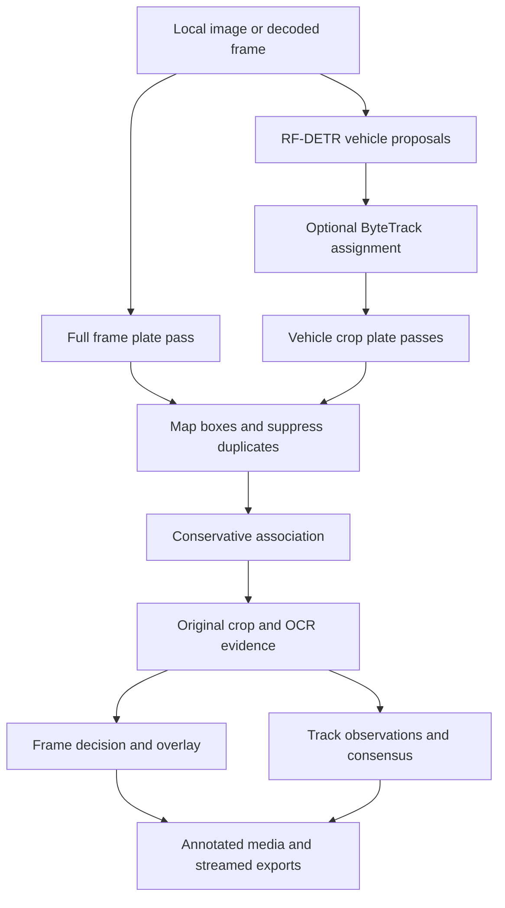

# Architecture

The consolidated version 1.0 specification appears in the original session transcript under `FINAL TECHNICAL SPECIFICATION`. The application keeps the original pretrained stack and local deployment. The source tree is a workspace snapshot without Git metadata. The baseline was copied before edits and reproduced from the available source and weights.

## Detection and association

Full media resolution is retained. RF-DETR detects car, motorcycle, bus, and truck. In video, lower-scoring vehicle proposals reach ByteTrack. A proposal below the visible vehicle threshold needs a track ID to appear. High scoring detections survive before ByteTrack confirms an ID. Per-frame vehicle indices distinguish image vehicles and untracked detections.

RT-DETR handles full-frame and expanded vehicle crops in configurable batches. YOLOv9 retains the same ROI policy and a separate model threshold. Recovery adds overlapping tiles for larger frames. Boxes are checked for finite coordinates, clipped to their inference ROI, and moved back to source coordinates. Plate NMS keeps the highest scoring box and its contributing pass boxes. A full-frame pass can recover plates where the vehicle detector misses.

Association requires a contained center, sufficient overlapping plate area, and a margin over a competing containing vehicle. Credible multiple plates for one vehicle are retained as unassociated. Geometric containment and runner-up containment are exported separately from detector scores.

## Reading policy

The primary OCR uses the original plate crop with a small margin. Quality gates use the unexpanded region in source pixels so a padded or resized crop cannot clear a size gate. Evidence includes width, height, contrast, median intensity, sharpness, shadow and highlight fractions, and frame clipping. CCT exports the model's scores for all slots and separately for emitted characters. Frame gating uses the weakest emitted character and mean score. Raw text is retained with its candidates, transformations, and format plausibility.

| Frame state | Meaning |
| --- | --- |
| READ | Original primary text passes detection, quality, format and OCR gates, or meets the lower OCR gates with a qualifying independent agreement |
| LOW_CONFIDENCE | A primary or alternative candidate exists with insufficient support or a disagreement |
| UNREADABLE | The plate is associated and no reader returned a candidate |
| UNASSOCIATED | Geometry could not reliably attach the box to a vehicle. OCR evidence remains available |
| NO_PLATE_DETECTED | A vehicle was detected and no plate was reliably attached |

Enhanced contrast and flattened row views are labeled alternatives. They use the same OCR weights and contribute no independent votes. Optional PaddleOCR runs in a separate CPU subprocess on selected difficult crops. OCR scores from different models are retained on their own scales. The format check covers common state and UT formats, Delhi single digit zones, Bharat Series, and legacy Odisha and Telangana codes. It performs no registry lookup or character substitution.

## Tracking and video exports

ByteTrack operates on analyzed frames, so the tracker lost buffer counts analyzed frames. The system retains a bounded candidate history for each active track, retires lost tracks, and keeps compact summaries for exports. Whole strings vote with crop-quality weights. Exact duplicate crop content contributes a single vote, and support must come from separated source timestamps. The winner requires a margin, sufficient weight share, credible original OCR evidence, and stable vehicle class for a final track READ. Competing strings of different lengths stay separate. The frame overlay uses frame text and frame status. Track summaries carry a separate candidate, agreement, and best and supporting source frame indices.

Video frames are decoded and written incrementally. Raw observation rows spool to disk and are replayed to JSON and CSV. The app returns a bounded preview and includes all rows in downloads. Timing samples and compact track summaries grow with the run, up to the configured frame cap. Batch outputs reuse the same models and retain successful work if another image cannot be decoded. Capture, writer, spool, and optional OCR worker resources are closed after processing.

The video writer validates the encoded frame count before publishing the MP4. Metadata records partial decode, cancellation, configured limits, original and encoded dimensions, sampled and decoded counts, settings, and model checksums. Raw-stride gaps appear as source frames in the preview. Timestamps prefer decoder timestamps, with FPS-based fallback. Successful exports are local. Treat exported plate text, timestamps, and footage as sensitive and apply appropriate access and retention rules.
